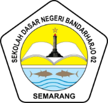

## 🚀 Menjalankan di Komputer

Butuh **Node.js 18+**.

```bash
npm install
npm run dev        # buka http://localhost:5173
npm run build      # hasil produksi di folder dist/
npm run preview    # uji hasil build
```

<div align="center">



# Website SDN Bandarharjo 02 Semarang

**Website resmi sekolah dasar yang ceria, interaktif, dan dilengkapi _Kuis Cerdas_ berbasis machine learning.**


</div>

---

## 📖 Tentang Proyek

Proyek ini adalah **peningkatan (upgrade) website SDN Bandarharjo 02 Semarang**, sekolah dasar negeri di Kecamatan Semarang Utara, Kota Semarang. Website lama (`sdnbandarharjo02.dikdas.semarangkota.go.id`) bertampilan standar portal dinas; website baru ini dirancang ulang agar:

- 🎨 **Menarik & ramah anak**: warna diambil dari logo sekolah, penuh animasi ceria.
- 📱 **Responsif**: nyaman dibuka di HP, tablet, maupun komputer.
- 🧠 **Edukatif**: ada **Kuis Cerdas** yang soalnya menyesuaikan kemampuan tiap anak (machine learning).
- 🛠️ **Mudah dikelola**: seluruh isi (berita, pengumuman, galeri, kontak) cukup diedit di **satu file**.

> Struktur dan pendekatan teknis mengacu pada proyek sebelumnya, **Nepal Van Java** (Vite + HTML/CSS/JS murni, tanpa framework).

## 🖼️ Cuplikan Tampilan

> Foto latar pada cuplikan ini masih **gambar dummy** dan akan diganti foto asli sekolah.

| Beranda (hero) | Sambutan & marquee |
|---|---|
|  |  |

| Kuis Cerdas (soal) | Kuis Cerdas (hasil) |
|---|---|
|  |  |

## ✨ Fitur

### Halaman
| Halaman | Isi |
|---|---|
| **Beranda** | Hero animasi, statistik sekolah, sambutan kepala sekolah, keunggulan, promo kuis, berita, strip galeri, pengumuman |
| **Profil** | Tentang sekolah, visi & misi, fasilitas |
| **Akademik** | Daftar mata pelajaran, ekstrakurikuler |
| **Lomba** | Info lomba & prestasi |
| **Galeri** | Foto kegiatan dengan filter kategori + lightbox |
| **Kuis Cerdas** | Kuis asah otak adaptif (lihat bagian di bawah) |
| **Pengumuman** | Daftar pengumuman resmi |
| **Kontak & Pengaduan** | Alamat, peta, formulir yang terkirim lewat WhatsApp |
| **Tautan** | Dropdown ke Dinas Pendidikan, Kemendikdasmen, Rapor Pendidikan, dll. |

### Animasi & Interaksi
- Preloader logo memantul
- **Kursor kustom** (titik + cincin) dengan **jejak bintang** dan ledakan bintang saat klik
- Background hero bergerak: foto zoom + parallax, awan melayang, ikon melayang mengikuti mouse, ombak
- Header transparan yang berubah solid saat scroll, menu dengan teks bergulir
- Angka statistik berhitung naik, teks ketik otomatis, reveal bertahap saat scroll
- Kartu miring 3D, tombol magnetik + ripple, marquee teks & foto berjalan
- Progress bar scroll dan tombol kembali ke atas
- Menghormati pengaturan *reduced motion* & otomatis mati di layar sentuh

## 🧠 Kuis Cerdas (Fitur Machine Learning)

Kuis asah otak untuk siswa SD dengan maskot burung hantu **Pak Hoot**, roket penanda progres, timer, suara, konfeti, dan papan juara.

**Topik:** 🧮 Hitung Cepat · 🔢 Pola Angka · 🎨 Pola Gambar · 🧩 Logika (10 tingkat kesulitan, soal dibuat otomatis).

**Cara kerja "Otak AI"** (`assets/js/quiz-engine.js`):

1. **Regresi logistik online (SGD)** memprediksi peluang anak menjawab benar:  
   `p = σ(w · x)`, lalu setelah tiap jawaban bobot diperbarui `w ← w + η(y − p)x − ηλw`.  
   Fitur `x`: bias, tingkat soal, topik (one-hot), akurasi topik, akurasi 5 soal terakhir, kecepatan menjawab.
2. **Estimasi kemampuan per topik** dengan *Item Response Theory 1PL* (mirip rating Elo).
3. **Pemilihan soal adaptif**: dipilih soal yang peluang benarnya paling dekat **70%** (zona belajar optimal), dengan bonus untuk topik terlemah.

**Catatan penting**
- Ini ML **ringan yang berjalan di browser**; data tersimpan di `localStorage` perangkat anak, **tanpa server dan tanpa mengirim data apa pun**.
- Ini **bukan tes IQ klinis**, hanya latihan asah otak. Hasil disebut *Skor Pintar* dan *Level Otak*.
- Pengembangan lanjutan: model Python (scikit-learn) atau TensorFlow.js dengan data banyak siswa.

## 🧰 Teknologi

- **Vite 5**: multi-page build
- **HTML5, CSS3, JavaScript (ES Modules)**: tanpa framework
- **Google Fonts**: Fredoka & Nunito
- **Web Audio API & Canvas**: efek suara, konfeti, grafik hasil kuis
- **Vercel**: hosting

## 📁 Struktur Folder

```
sdn-bandarharjo-02/
├── index.html                  # Beranda
├── pages/                      # profil, akademik, lomba, galeri, kuis, pengumuman, kontak
├── assets/
│   ├── css/
│   │   ├── base.css            # variabel warna, tipografi, tombol
│   │   ├── layout.css          # header, menu, footer
│   │   ├── effects.css         # preloader, kursor, background bergerak
│   │   ├── pages.css           # tampilan tiap halaman
│   │   └── quiz.css            # tampilan kuis
│   └── js/
│       ├── data/content.js     # ⭐ ISI WEBSITE (edit di sini)
│       ├── main.js             # menu, render data, galeri, form
│       ├── components.js       # header & footer
│       ├── effects.js          # semua animasi
│       ├── quiz-engine.js      # Otak AI (machine learning)
│       └── quiz-ui.js          # tampilan & alur kuis
├── public/assets/images/       # logo, hero-bg, sambutan, galeri/
├── docs/screenshots/
├── vite.config.js
└── vercel.json
```

## ✏️ Mengelola Konten

Semua isi website ada di **`assets/js/data/content.js`**:

| Yang ingin diubah | Variabel |
|---|---|
| Alamat, email, telepon, nomor WhatsApp, sosial media | `SITE` |
| Statistik beranda | `STATS` |
| Berita / Pengumuman / Lomba | `BERITA` / `PENGUMUMAN` / `LOMBA` |
| Foto galeri | `GALERI` |
| Mata pelajaran | `KURIKULUM` |
| Menu Tautan | `TAUTAN` |

**Mengganti foto:** timpa file di `public/assets/images/` (`hero-bg.jpg`, `page-hero.jpg`, `sambutan.jpg`) dan `public/assets/images/galeri/` dengan nama yang sama, atau ubah nama file di `content.js`.

## ☁️ Deploy ke Vercel

1. Push project ke GitHub.
2. Di Vercel: **Add New Project** → pilih repository.
3. Biarkan pengaturan bawaan (`vercel.json` sudah disiapkan). Klik **Deploy**.

## ⚠️ Status & Catatan

Proyek ini masih dalam tahap pengembangan. Beberapa hal **masih placeholder** dan harus diganti data asli sebelum rilis:

- [ ] Nomor WhatsApp (formulir pengaduan) dan link sosial media
- [ ] Data bertanda **"CONTOH"**: jumlah siswa/guru, akreditasi, visi-misi, berita, pengumuman, nama kepala sekolah
- [ ] Foto latar & galeri (saat ini gambar ilustrasi dummy)
- [ ] Sejarah singkat sekolah dan daftar ekstrakurikuler
- [ ] Review bank soal logika oleh guru agar sesuai kurikulum

## 🗺️ Rencana Pengembangan

- Halaman detail berita
- Data guru & tenaga kependidikan
- Topik kuis tambahan (memori, bahasa)
- Hero foto berbeda di tiap halaman

## 🙌 Kredit

- Dikembangkan sebagai proyek untuk **SDN Bandarharjo 02 Semarang**
- Referensi struktur: proyek *Nepal Van Java*
- Pengembang: _(isi namamu di sini)_ · Dosen pembimbing: _(isi nama dospem)_

---

<div align="center">Dibuat dengan ❤️ untuk generasi cerdas Bandarharjo</div>